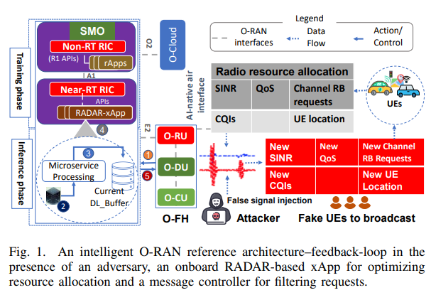
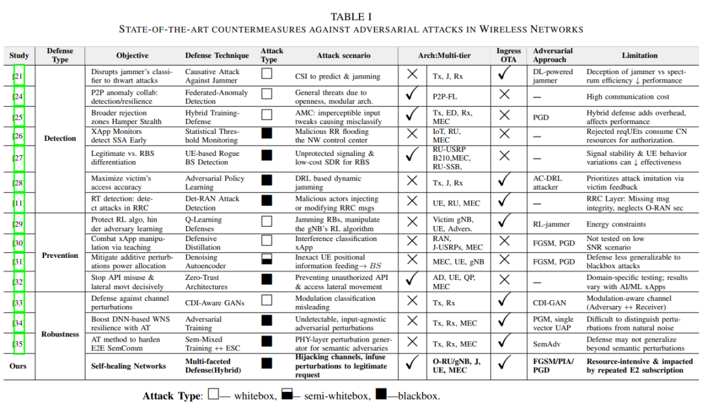
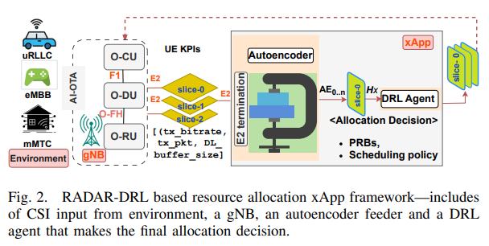
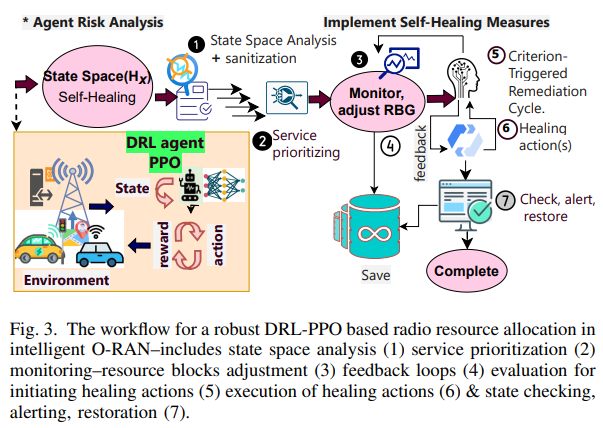
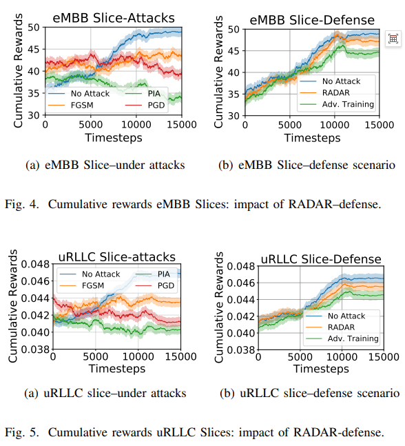
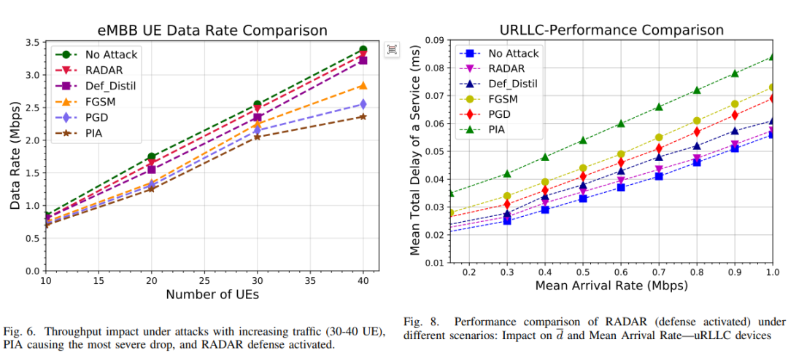

# [Resource Allocation] RADAR: Robust Deep Reinforcement Learning-Based Resource Allocation Method for Adversarial Attacks in Smart O-RAN

Introduction: The Open Radio Access Network (O-RAN), driven by the O-RAN Alliance, is poised to revolutionize the green telecommunications ecosystem. This global consortium, comprised of over 300 mobile operators, vendors, and research institutions, aims to transform the industry through the promotion of intelligent, open, virtualized, energy-efficient, and fully interoperable mobile networks. O-RAN supports multi-vendor interoperability by allowing operators to choose the best solutions among similar ones, fostering competition. This expands the market for new participants, prevents monopolization by a few companies, and enhances supply chain security [1]. Additionally, one of the key transformational features of O-RAN is its integration of core network functions with artificial intelligence (AI) to improve energy efficiency and enable software-driven optimization in green networking for the sixth-generation (6G) network [2-4]. Key AI-assisted O-RAN functionalities are expected to be implemented in wireless access network intelligent controllers (RICs) at both the edge and cloud sides of O-RAN [5]. Generally, AI-assisted RIC applications aim to leverage data analytics for traffic prediction and resource allocation optimization [6-8]. However, like AI-based computer vision technologies, the AI-driven platforms and open interfaces in O-RAN also present unique challenges related to adversarial attacks [9].
For example, attackers can initiate physical adversarial attacks where compromised users or signal jammers can forge signal power to deceive the resource allocation state observation of deep reinforcement learning (DRL) agents [10]. As shown in Figure 1, common attack scenarios include an attacker targeting near-real-time (near-RT) RIC applications within O-RAN such as resource allocation. The process begins with a compromised user equipment (UE) sending a signal request to the O-RU normally. However, malicious agents exploit this by using the compromised/faked UE identity to broadcast false channel quality indications (CQI)/channel resource requests during training, injecting fake signals into the system. This type of attack results in a 77.74% decrease in packet delivery rate. On the other hand, literature [11] and [12] indicate that attackers can manipulate AI/ML models used in xApps and rApps by exploiting vulnerabilities in uplink signals and RIC observations, isolating and hijacking targeted UEs [11]. With the core objective of multi-vendor and component diversity in O-RAN leading to increased complexity, its attack surface also expands [13-15], as its source code and AI-based architectures are openly available for research and improvement. Architecture modifications such as Lower Layer Separation (LLS) and Open Fronthaul (7-2x), along with trust chain disentanglement hardware and software, further complicate the construction of effective defense methods.
Reducing the intensity of attacks and preventing functional cascading failures based on AI in O-RAN is crucial. Unlike the computer vision field, defense techniques against adversarial attacks in O-RAN remain an open challenge, with limited targeted research. This challenge stems from the difficulty of detecting subtle perturbations in hundreds of benign user signals and natural interference noise in wireless communication physical channels [18]. Below is a literature review summary of our latest defensive methods for AI-assisted O-RAN functions.
A. AI-assisted O-RAN resource allocation and core functionalities: There have been multiple studies in the latest defense methods literature on adversarial attacks in wireless networks, but few have specifically focused on DRL-based resource allocation applications. For instance, recent reviews [19,20] summarize several typical adversarial attack and defense methods, such as adversarial training, ensemble defense, model masking, and input masking. However, most methods are targeted at the field of computer vision or general 5G networks. Table I comprehensively evaluates the latest defense methods, detailing their objectives, technologies, attack scenarios, architecture, and limitations, particularly targeting the core functions of wireless network and AI-assisted O-RAN resource allocation. Consequently, researchers in the literature have proposed methods such as causal attacks against jammers [21-23] to disrupt the attacker's ability to effectively classify and interfere with communication. However, these technologies are difficult to distinguish legitimate signals from adversarial signals at the physical layer, which may lead to misclassification errors. Co-opesition federated learning for anomaly detection has also been studied [24] to leverage collective intelligence of distributed nodes, but it brings high communication overhead. A wider rejection region achieved through hybrid adversarial training and on-the-fly defenses [25] is proposed to obstruct the concealment of adversarial examples, but distributed defense mechanisms introduce complexity in effective coordination and resource allocation. Additionally, monitoring network messages and employing threshold-based statistical analysis [22,26] can enable early detection of specific attacks such as synthetic signal attacks (SSAs), but the effectiveness of this technology may vary depending on the specific attack scenario. Overall, the key open challenge for O-RAN adversarial defense is to balance between robustness and generation learning accuracy while minimizing misclassification errors and computational/communication overhead.
Defense methods that combine techniques such as adversarial learning, model modification, and input masking can significantly mitigate the impact of adversarial attacks. For example, [29] proposes MisNACK and RandomOpt/RandomTop to protect reinforcement learning algorithms by hindering attackers from learning and providing them with incorrect information during training, but prioritizes imitation of specific attacks during this process. However, this random sampling method may make systems vulnerable to novel or unknown attack vectors. Research [31] introduces denoising autoencoders to alleviate additive noise in power allocation scenarios. However, energy constraints and security key management requirements pose challenges to this input mask-based defense strategy, especially in large-scale networks with thousands of users. In recent studies, defensive distillation [30] has been explored to counteract manipulations in AI-driven resource allocation within O-RAN through a teaching process. The defensive distillation method reduces the attack success rate from 0.9 to 0.06. Although defensive distillation increases the difficulty of constructing adversarial samples by reducing the information content of model gradients, attackers can still adjust their strategies by averaging multiple perturbed versions of the input. [36] proves that by optimizing an effective objective function, it is possible to bypass defensive distillation. Specifically, its Carlini&Wagner (C&W) technique introduces an improved loss function, which effectively improves the efficiency of adversarial attacks even when defensive distillation is applied. A critical research gap is the lack of comprehensive methods for data cleaning and gradient obfuscation across multiple stages to defend against white-box adversarial attacks exploiting gradient optimization or approximations, as well as black-box penetrations in DRL-assisted resource allocation.
Optimizing multimodal models can enhance the robustness of AI-assisted wireless systems against adversarial attacks, for example, by combining adversarial training with generator and discriminator mechanisms in integrated learning or Generative Adversarial Networks (GANs) to mitigate the impact of adversarial perturbations on gradients and AI-based signal modulation classifiers [33]. A second attempt to combine adversarial training and generative model techniques has been developed in literature [34] to improve resilience of deep neural network (DNN)-based wireless slice applications. Similarly, a method that combines data cleaning with adversarial training is deployed in literature [37] to protect vehicle-to-infrastructure communication based on Support Vector Machines (SVM) in onboard networks. These approaches have not been specifically designed for DRL-based resource allocation within O-RAN. Literature [35] proposes SemMixed, an adversarial training method that enhances the capability of end-to-end semantic communication against semantic attackers. However, this model was built for a hypothetical semantic communication environment based on transformers, rather than the core functionality of O-RAN. The model is also susceptible to time-series-based attack strategies.
B. Contributions and Previous Work: This study introduces a hybrid approach that integrates multiple defense mechanisms, including adversarial input purification, data augmentation, and adversarial training. Our new method enhances the gradient confusion and purification of resource allocation in O-RAN based on Deep Reinforcement Learning (DRL) during both inference and training stages, an area not yet explored in the literature. This approach enables O-RAN systems to counteract more broadly-based adversarial threats, including high-risk attacks such as signal manipulation and strategic penetration [38], while maintaining a balance between robustness and generation learning accuracy. To our knowledge, this is the first time a multi-layered approach has been proposed and thoroughly analyzed for various specific vulnerabilities of O-RAN. Consequently, unauthorized access to the open forwarding of Ethernet L1 (O-RU to O-DU interface) often poses significant risks. Attacker can exploit vulnerabilities to inject malicious commands or intercept data, highlighting the necessity of integrated, sequential defenses (such as adversarial input purification and adversarial training) for the design of O-RAN architectures. Moreover, ensuring consistency in reward learning strategies within resource allocation based on DRL requires explicit state observation, input enhancement, and defensive distillation of action decision making to reduce model sensitivity to minor signal perturbations. The main contributions of this study are summarized as follows:
This is the first attempt to propose a multi-level method targeting various O-RAN specific vulnerabilities, combining adversarial input pruning, active adversarial training, and O-RAN adaptive defense distillation technology. This integrated method provides comprehensive defense capabilities and enhances the overall resilience of the model.
This is the first attempt to address emerging threats related to O-RAN, including protecting legitimate network functions from spoofing, strategic penetration in RICs, gradient-based maximization of deceptive loss, and injection of perturbations into O-CU via O-DU inputs. We also provide performance comparisons between the proposed method and real O-RAN testbed datasets, demonstrating its effectiveness in real-world scenarios.
A large number of simulations have shown that our hybrid defense model performs excellently in maintaining UE QoS, especially under high traffic density, with stable performance indicators under various adversarial conditions (FGSM, PGD, PIA attacks).
The rest of this paper is structured as follows: Section I-A provides a critical analysis of related research; Section II outlines our network model and problem statement; Section III details the proposed attack models and defense strategies; Section IV-C presents experimental results, analyses, and discussions; finally, Section V summarizes the research and proposes future work suggestions. Table II lists the symbols used in this study.
Conclusion This paper introduces RADAR, a novel and resilient method for intelligent O-RAN system resource allocation, by enhancing adversarial defense through the addition of hierarchical security modules. RADAR aims to provide significant resilience against various adversarial attacks (especially strategy penetration attacks (PIA)), ensuring optimal resource allocation and high performance across enhanced mobile broadband (eMBB), massive machine type communications (mMTC), and ultra-reliable low-latency communication (uRLLC) slices. Our experimental results highlight the effectiveness of the proposed solution in mitigating adversarial perturbations, improving the robustness and reliability of the original resource allocation model. Notably, we observed a significant recovery in data rate performance from 22.01% to 67.90%, an improvement of 58.84% over optimal resource allocation decisions. Although the results are encouraging and compatible with DRL-based architectures, further improving the generalization ability of the defense model against adaptive attacks in multi-tenant O-RAN networks (especially in large wireless models (LWMs) and large multimodal models (LMMs) scenarios) remains a valuable research direction. Future work will focus on refining these strategies through advancements in incremental learning and integrated quantum machine learning to enhance the security and reliability of O-RAN in large-scale scenarios against evolving AI/ML adversarial threats and dynamic mobile user anomalies.

## Images

<!-- PAYMENT_BLOCK -->

## Get this dataset

- Payment link (Stripe): [Buy now](https://buy.stripe.com/3cs8yP7sY87d0vu9AB)
- Payment QR code: 

<!-- /PAYMENT_BLOCK -->
